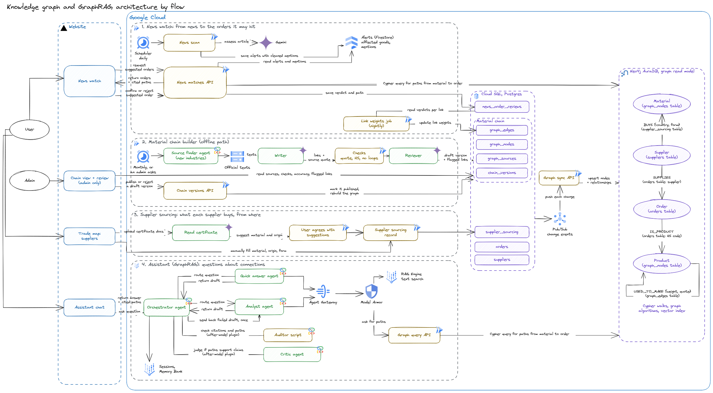

# ExportMate - Your AI Trade Companion

🌏 Export compliance, news impact and next steps for small manufacturers

ExportMate answers three questions for every export order: **what changed, does it affect my order,
and what should I do next?** **Gemini** reads regulations, supplier documents and trade news; a team
of **Google ADK agents** on **Gemini Enterprise Agent Platform** answers questions with a cited source
for every fact; and a **knowledge graph** traces how a news story about a raw material reaches a
finished order. 

🔗 Live: [https://exportmate-web-3v6cd2xhpq-as.a.run.app/](https://exportmate-web-3v6cd2xhpq-as.a.run.app/). "Explore the demo" opens a sample
workspace in the browser with no account; signing in opens a company workspace.

**Try it** with the demo company, Binh Duong Wood Co. (a Vietnamese plywood and furniture exporter):
sign in at [https://exportmate-web-3v6cd2xhpq-as.a.run.app/#/login](https://exportmate-web-3v6cd2xhpq-as.a.run.app/#/login) with

| Email | Password |
|---|---|
| `lan@example.com` | `testinguser123@` |

It has 13 orders to the EU, Asia and the US, five suppliers with what each buys, the playbook, the
trade map, News watch and the assistant with the knowledge graph. Please don't change the password.

> All legal and regulatory content is illustrative, the demo's stock is synthetic, and the news is
> real. Alerts and answers are AI assessments, not legal advice.

---

## ✨ Features

### 📦 Orders and analysis

- **Import orders** from a CSV: every row is validated before import, and imported orders are analysed
  straight away.
- **Analysis report per order:** the order is checked against its destination market's checklist, the
  supplier's documents and the company's own playbook rules. The report lists each gap, the official
  text behind it and the estimated cost, and sets the order's status (in the clear, or action needed).
- **Next moves** on each report open the right fix in place: the order's HS code, destination or ship
  date, or the supplier's record.
- **HS code suggestions** for an order without one, from the company's past orders and the official
  tariff lines (vector search with **pgvector**).
- **Status by hand**, one order or many, with a required note; every change is kept as the order's
  history.

### 📜 Rules and regulations

- **Regulations:** official texts with their version history. **Gemini drafts a market's
  requirements** from the text, each line quoting its source, and the owner reviews them before they
  count.
- **Rule watch:** checklist lines that take effect or change in the next 90 days, in the markets of
  open orders.
- **Playbook:** the company's own **WHEN/THEN rules** (margins, documents, supplier deadlines), checked
  in every analysis.

### 🛠️ Acting on a gap

- **Suggested solutions:** Gemini writes a summary and steps for each gap from the report's facts, the
  cited text and the team's notes on earlier fixes; every number and link is checked against what it
  was given. Solutions are saved, reused for later orders and listed in the **Knowledge base**, and
  expire when the rule changes.
- **Supplier messages:** Gemini drafts an email asking the supplier for what's missing; the owner
  approves it, and it's sent once.
- **Reports:** order and company reports, editable, exported as PDF with every edit highlighted, and
  emailed.

### 🗺️ Suppliers and the trade map

- **Trade map:** destinations, suppliers, production sites and routes on a 3D globe.
- **What if:** compare another destination, ship date or transit hub, see which documents carry over
  and which requirements need another check, and save the comparison with a note. Gemini can start
  the note from a reading of the comparison.
- **Supplier certificates:** upload one and **Gemini reads it**: the number, issuer, expiry, and what
  the supplier buys (material, origin country, form), which becomes the supplier's sourcing.

### 📰 News watch

- **Daily news scan:** trade news from built-in and company-added feeds. Gemini reads each article and
  pulls out the goods it affects and what it names (materials, HS codes, origin countries, markets).
  **Model Armor** screens articles for prompt injection first.
- **Orders it may hit:** the **knowledge graph** finds the open orders an article reaches, with the path
  and a source on every link. The team confirms or rejects each match, and links people keep rejecting
  are avoided.

### 💬 The assistant

- Opens from every screen: ask about your orders, rules, news, stock, or how to use the app.
  [Questions to try](docs/ASSISTANT_QUESTIONS.md), by use case.
- **Connections (GraphRAG):** "what if Vietnam restricts acacia log exports?" The assistant walks the
  knowledge graph and names each order with the path that reaches it.
- **Checked answers:** every fact carries a **numbered citation**. An auditor checks citations and
  figures, and a critic checks each claimed connection against its path; a failing draft is redone once.
- **Audit trail:** each answer's steps, the agent and tools behind them, and the checks, live and saved.
- **Memory:** remembers a signed-in user's preferences (**Memory Bank**); Account › What the assistant
  remembers lists them and forgets any on request.
- **How it works:** **Google ADK** agents on **Agent Platform's Agent Runtime**. A router sends each
  question to a quick-answer agent or an analyst, which call read-only tools (orders, playbook, news,
  stock, **RAG Engine** search, the knowledge graph) through **Agent Gateway** with **Model Armor**.
  More in [docs/AI_GUIDE.md](docs/AI_GUIDE.md) and [docs/AGENT_HARNESS.md](docs/AGENT_HARNESS.md).
- **Beyond the chat**, Gemini drafts requirements, reads certificates, assesses news, writes solutions
  and supplier emails, and builds the material chain, with code checking each answer before it's saved.

### 👥 Team and accounts

- Sign-in with **Firebase Auth** (email or Google), company workspaces, invites, and owner, editor and
  viewer roles.
- An **activity log** of every change, exportable as CSV.
- **Browser demo:** the full workspace in the browser with sample orders, no account needed.

---

## 🧩 The Knowledge Graph

News rarely names your order. A story about **acacia logs from Vietnam** never mentions plywood or
PO-2291, yet the order depends on it. The knowledge graph connects them.

```
Binh Phu Wood ──BUYS (Vietnam, logs)──► acacia
logs ──USED_TO_MAKE──► veneer ──USED_TO_MAKE──► plywood
PO-2291 ──IS_PRODUCT──► plywood        Binh Phu Wood ──SUPPLIES──► PO-2291
```

- **What's in it:** materials, products (HS headings), suppliers and orders. Every *used to make* link
  quotes an official text, covering every commodity in the EU deforestation rule.
- **How it's built:** offline, a **Gemini writer** proposes links, code checks each quote and HS code,
  and a **Gemini reviewer** flags doubtful ones; a chain admin publishes each new version.
- **Where it lives:** **Cloud SQL Postgres** is the source of truth; **Neo4j AuraDB** holds a copy that
  the walk queries with **Cypher**.
- **How it learns:** people confirm or reject the orders it suggests, and a nightly job turns those
  verdicts into link weights.

📖 Details (data model, the walk, verdicts, the builder, Neo4j):
[backend/app/knowledge_graph/README.md](backend/app/knowledge_graph/README.md).

### 🚀 Architecture



1. **News watch:** the daily scan saves alerts; the News matches API walks the graph for the orders
   each alert reaches and keeps the user's verdicts.
2. **Material chain builder (offline):** official texts become cited links, published as a reviewed
   version.
3. **Supplier sourcing:** Gemini reads an uploaded certificate, and what the user confirms becomes
   the supplier's *buys* links.
4. **Assistant (GraphRAG):** the agents ask the Graph query API for paths, through Agent Gateway and
   Model Armor, and cite each order's path in the answer.
5. **Data:** each change in Postgres goes through **Pub/Sub** to a sync endpoint that updates Neo4j.

---

## ☁️ Google Cloud

Everything runs in one project, defined in [`infra/terraform`](infra/terraform/).

| Service | What ExportMate uses it for |
| --- | --- |
| Gemini | the assistant, news assessment, regulation drafting, certificate reading, solutions, supplier emails, the material chain builder |
| Agent Platform: Agent Runtime, Sessions, Memory Bank | the ADK agents, each chat's session, per-user memories |
| Agent Platform: RAG Engine | search over stock, articles, alerts, sources and help guides |
| Agent Platform: Evaluation | golden-set runs scored by managed judges |
| Agent Identity, Agent Registry, Agent Gateway, Model Armor | the agents' identity, the endpoints they may call, their egress, prompt-injection screening |
| Cloud Run | the website (`exportmate-web`), the AI service (`exportmate-ai`), the backend (`exportmate-backend`, including the Graph query API and the graph sync endpoint), the link weights job, and a job for seeding, indexing, scans and evals |
| Cloud SQL (Postgres + pgvector) | company data, the trade map, regulations, the knowledge graph's source of truth and chain versions, HS code vectors |
| Pub/Sub | change events that keep Neo4j in step with Postgres (a push subscription to the graph sync endpoint) |
| Firestore | news, alerts, stock, chat audits, the answer cache |
| Cloud Storage | the files RAG Engine indexes, uploaded documents |
| Cloud Scheduler | the daily news scan and the nightly link weights job |
| Secret Manager | the Neo4j password and other credentials |
| Cloud Build, Artifact Registry | building and storing the images |
| Cloud Logging and Monitoring | JSON logs, log-based metrics, alerts and dashboards |

Outside Google Cloud: **Neo4j AuraDB** holds the graph read model, and Firebase Auth signs people in.

---

## 📁 Repository

| Folder | What it is |
| --- | --- |
| [`frontend/`](frontend/) | React 19 + TypeScript + Vite app; the chat and News watch UI live in [`frontend/ai/`](frontend/ai/) |
| [`backend/`](backend/) | FastAPI + Postgres company API; see [`backend/README.md`](backend/README.md) |
| [`ai/server/`](ai/server/) | Node service: the ADK agents, News watch and search |
| [`infra/`](infra/) | Terraform, Agent Platform governance, monitoring |
| [`docs/`](docs/) | AI guide, agent harness, architecture diagrams |
