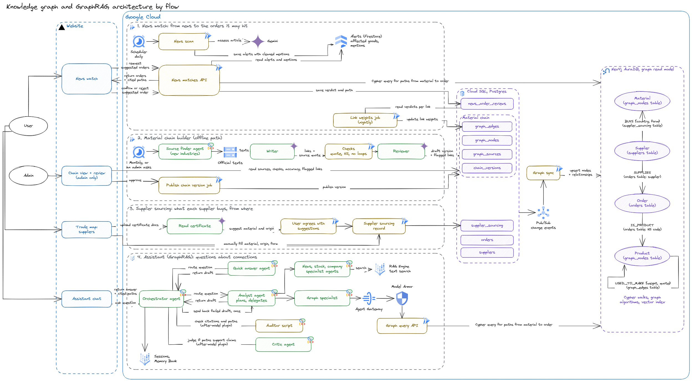

# Knowledge graph

How News watch finds the orders an article may hit by following links (material → products
made from it → suppliers that buy it → their orders), not only by comparing HS codes. Why, and
the business decisions: phase 1 of [`docs/NEWS_IMPACT_PLAN.md`](../../../docs/NEWS_IMPACT_PLAN.md).
This file is the technical side: the data, how the walk works, what's built and what's next.

Target architecture (the finished system; section 1 says what's built today):



Edit it in [`docs/knowledge-graph-architecture.excalidraw`](../../../docs/knowledge-graph-architecture.excalidraw)
(open at excalidraw.com), generated by `docs/knowledge_graph_architecture.py`; the image is exported
from it with `.claude/skills/architecture-diagram/export_png.mjs`.

## 1. Status

### Done

| # | Step | Where |
| --- | --- | --- |
| 1 | Plan, and where the material chain comes from | `docs/NEWS_IMPACT_PLAN.md`, section 3 below |
| 2 | Seed data: EUDR Annex I parsed (93 codes, 7 commodities), the wood chain (14 products, 25 links, each citing FAO or the HS headings), 11 materials | `data/`, `build_eudr_products.py` |
| 3 | Tables and loading: graph nodes, edges and sources (reference seed), supplier sourcing (company seeds) | `database/models/knowledge_graph.py`, `seed_reference_data.py`, `seed_demo_data.py` |
| 4 | The walk, and News watch suggestions from it with a cited path; the HS-heading rule kept as one path | `services/knowledge_graph.py`, `services/news_matches.py` |
| 5 | The news scan records what each article names (`mentions`) | `ai/server/scan.js`, `ai/server/mentions.js` |
| 6 | News watch shows the path under each suggestion, with source links | `frontend/ai/news/NewsOrders.tsx` |
| 7 | Deployed to `skilful-scarab-511320-q9` and checked live (16 Oct 2026): a real scan's alerts reached orders through suppliers | |
| 8 | Broad words ("timber", "hardwood") and product words ("plywood", "logs") | `genericTerms`, `aliases` in `material_chain.json`; `services/graph_words.py` |
| 9 | Links checked by AI (`aiCheck`), less common routes marked `secondary`, two missing links added | `material_chain.json` |
| 10 | Sourcing on the supplier form and API ("Materials it buys") | `services/supplier_sourcing.py`, `frontend/src/trade-map/forms.tsx` |
| 11 | AI suggests sourcing from uploaded certificates; a person ticks what to keep | `services/supplier_documents.py` |
| 12 | Measuring: each verdict keeps how it was found; `GET /news-matches/accuracy`; expected mentions in the scan eval (first run: 100% mention recall) | `services/news_matches.py`, `ai/server/eval/scan-*.js` |
| 13 | Steps 8–12 deployed from main (`ca87b60`) and rechecked live (17 Oct 2026): "hardwood" now reaches orders through suppliers; furniture paths go through sawn wood | |
| 14 | Verdicts used automatically: links people keep rejecting are doubted, avoided when an equally short path exists, and marked on the path | `services/graph_feedback.py` |
| 15 | Material chain page (Rules & news): links with sources, checks and verdicts, and how each way of suggesting did | `GET /knowledge-graph/chain`, `frontend/src/MaterialChain.tsx` |
| 16 | Offline building pipeline: sources → writer → code checks → reviewer → one revision → draft → release (section 7) | `build_chain.py`, `data/industries.json` |
| 17 | Cocoa (6 links) and coffee (4 links) built by the pipeline, read and released; the reviewer rechecked wood's 25 links (all agreed) | `data/industries/`; origin countries added (Ghana, Côte d'Ivoire, Cameroon, Nigeria, Ecuador, Colombia, Peru, Honduras, Ethiopia, Uganda) |
| 18 | Stronger sources: the pipeline reads official documents that define what each product is made from (EU cocoa and chocolate directive, EU coffee extracts directive, Codex standard for named vegetable oils, FAO definitions); cocoa (9 links) and coffee (5) rebuilt, oil palm (17) added; links quote a definition where one exists, a product list otherwise (lower confidence) | `data/industries.json` `documents` |
| 19 | The pipeline owns wood: rebuilt from the FAO and JFSQ definitions, all 14 product keys kept; 9 links no text quoted yet stayed hand-curated for a while | `data/industries/wood.json` |
| 20 | Every EUDR commodity has a chain: soya, rubber and cattle added | `data/industries/` |
| 21 | Stronger sources, one research round for every industry: HS chapter notes (WCO), EU Ecolabel criteria (furniture, floor coverings), U.S. Commerce scope texts (wooden cabinets, millwork), a CBP ruling (glulam from sawn boards), U.S. rules (40 CFR 428 and 63.6015 for rubber goods, 21 CFR 801.437 for latex, 21 CFR 163 for cacao), EU Regulations 853/2004 (meat, offal) and 1069/2009 (hides), EPA AP-42 (leather tanning), Codex soy protein products, the International Coffee Agreement 2007. Cattle gained hides and leather (EUDR 4101, 4104, 4107). Every link quotes a text; the hand-curated links (`extraLinks`) are gone. 7 industries, 71 products, 85 links | `data/industries.json`, `data/industries/` |
| 22 | Pipeline: a rebuild offers the writer the current links to keep when a source quotes them and lists those it lost (`linksNoLongerSourced`); a long document names what to keep when cut (`focus`); an API answer is read from one field (`jsonField`, CBP rulings); a failed quote check says which part failed, so the revision can fix it | `build_chain.py` |
| 23 | News watch runs in `skilful-scarab`: alerts carry `mentions`, so live suggestions walk the graph (18 Oct) | `infra/terraform/README.md` |
| 24 | GraphRAG in the assistant: `GET /knowledge-graph/query` runs the walk for what a question names; the `query_graph` tool and a graph specialist give the agents the paths; the auditor wants each order's path cited and a critic (Gemini) checks the answer's connections against the paths | `services/graph_query.py`, `ai/server/agents/tools.js`, `ai/server/critic.js` |
| 25 | Link weights job (nightly): every company's verdicts per link, with a weight, in `graph_link_weights`; walks read cross-company doubt and weights from it (a company's own verdicts stay live), and prefer higher-weight links between otherwise equal paths; Rules & news › Material chain shows them | `app/update_link_weights.py`, `services/graph_feedback.py`, `infra/terraform/backend_service.tf` |
| 26 | Chain versions: each industry's chain in Postgres (`chain_versions`), the files in `data/industries/` as first published versions; a changed file (or, next, the pipeline) makes a draft; chain admins (`CHAIN_ADMIN_EMAILS`) see its changes and flags on Rules & news › Material chain and publish it (the graph is rebuilt) or reject it | `services/chain_versions.py`, `frontend/src/ChainReview.tsx` |
| 27 | Neo4j (AuraDB Free) as the graph's read model: each commit that changes the graph is a change event (Pub/Sub, pushed to the backend), which copies it from Postgres into Neo4j; the chain walk runs as Cypher there while Neo4j holds the same chain as Postgres, else on Postgres (section 9) | `database/graph_changes.py`, `services/graph_sync.py`, `services/graph_store.py`, `database/queries/neo4j_graph.py`, `infra/terraform/graph_sync.tf` |

### Next

| # | Step | Why |
| --- | --- | --- |
| 1 | Industries outside the EUDR (textiles, metals, …): find official definitions first, then add them to `data/industries.json` | Every EUDR commodity is covered |
| 2 | Lists still behind a few links: oil palm's derivatives quote EUDR Annex I ("produced using oil palm": law, but a list), rubber's retreading and unvulcanised forms and coffee preparations quote HS headings. No better official text was found (ISO 2000 for rubber is paid; the Codex cocoa PDFs can't be fetched) | Rebuild when one turns up |
| 3 | More of the walk in Cypher (supplier sourcing to orders, not only the chain), and graph algorithms (which supplier is most central to a company's risk) | Neo4j now holds suppliers and orders too |
| 4 | Draw paths on the trade map | Demos |
| — | Housekeeping: re-seed the sample stock in `skilful-scarab` Firestore (`npm run seed`); 3 scan-eval cases fail on its old SKUs | Not graph work |

## 2. Data model

Postgres, next to orders and suppliers. A walk joins these tables to orders and suppliers instead
of copying them into a separate graph.

| Table | Rows | Scope |
| --- | --- | --- |
| `graph_sources` | What links cite: `eudr-annex-i`, `fao-jfsq`, `hs-nomenclature` (title, URL) | Shared |
| `graph_nodes` | `commodity.wood` (EUDR commodity, all its HS codes, its broad words), `wood.plywood` (a chain product, HS prefixes, words for it), `material.acacia` (species, scientific names, words, wood type) | Shared |
| `graph_edges` | `wood.veneer` *used to make* `wood.plywood`, or *by-product*; source and quote; `ai_check` (who checked it, verdict, why); `secondary` (used only when no equally short path avoids it) | Shared |
| `supplier_sourcing` | A supplier buys `material.acacia` from `VN` as `wood.roundwood`; `basis` (how we know) | Per company, through its suppliers |
| `news_order_reviews.via`, `.path` | How a reviewed suggestion was found (`supplier` / `hs`) and its steps | Per company |

```
Article "Laos limits acacia log exports"            (mentions from the scan)
   │ names acacia, LA, HS 4403
   ▼
supplier_sourcing: Binh Phu Wood buys acacia from LA as logs
   │ bought as
   ▼
graph_edges: logs ─used to make→ veneer ─used to make→ plywood     (FAO quotes)
   │ this order's product
   ▼
orders: PO-2291 acacia plywood (HS 4412.33) → EU
```

## 3. Where the data comes from

| Data | Source | Shared or per company |
| --- | --- | --- |
| Commodity → products | EUDR Annex I, parsed by `build_eudr_products.py` from the version the checklists cite | Shared |
| The chain (product → product) | Written from official sources, checked by AI (`aiCheck`), loaded by the reference seed | Shared |
| Supplier sourcing | The supplier form, certificates (AI suggests, a person keeps), demo seeds | Per company |
| Orders, suppliers | The company's own records | Per company |
| What an article names | Gemini in each news scan (`mentions`), cleaned by `mentions.js` | Per alert |

There is no public dataset of "HS code A is made from HS code B", so the chain is built from
official anchors and every link cites one:

| Source | What it gives | Use |
| --- | --- | --- |
| **EUDR Annex I**: Regulation (EU) 2023/1115 (in `seed_data/regulation_sources.json`); overviews [Prewave](https://help.prewave.com/en/articles/310638-eudr-relevant-hs-codes-based-on-annex-i), [Coolset](https://www.coolset.com/academy/which-products-are-covered-under-the-eudr-sector-by-sector-overview) | For wood, cocoa, coffee, oil palm, rubber, soya and cattle, the HS codes of every product made from them | Commodity → products. Official and citable |
| **HS structure**: [USITC HTS](https://hts.usitc.gov/), seeded as `hs_headings` (6,573) | Chapters run raw → processed: 4403 logs → 4407 sawn → 4408 veneer → 4412 plywood; 94 furniture | The steps of a chain |
| **FAO forest product definitions (JFSQ)**: [PDF](https://fao.org/forestry-fao/35789-0902b3c041384fd87f2451da2bb9237.pdf) | Roundwood → sawnwood, veneer, chips → panels, pulp → paper, in definitions we quote | The quotes behind 15 wood links |
| **UN BEC Rev.5**: [manual](https://unstats.un.org/unsd/trade/classifications/Manual%20of%20the%20Fifth%20Revision%20of%20the%20BEC%20(Edited)-%20EN.pdf); HS ↔ BEC/NAICS/BEA in the R [`concordance`](https://insongkim.r-universe.dev/concordance) package | Each HS code's stage: primary, processed, final | Ordering a new industry's chain |
| **Input–output tables**: [US BEA](https://www.bea.gov/industry/input-output-accounts-data); on an HS basis in the [Conconi appendix](https://conconi.ulb.be/Appendix_RoO.pdf) | Which industries buy from which | Later, suggesting links for many industries; coarse |
| **US Customs rulings (CROSS)**: [rulings.cbp.gov](https://rulings.cbp.gov/), as in the [ATLAS paper](https://arxiv.org/pdf/2509.18400) | Product descriptions → 10-digit HS codes | Mapping free-text products to HS codes |
| **EU Directive 2000/36/EC** on cocoa and chocolate products, Annex I: [EUR-Lex](https://eur-lex.europa.eu/legal-content/EN/TXT/?uri=CELEX:02000L0036-20131118) | "Cocoa butter designates the fat obtained from cocoa beans…", cocoa powder, chocolate | Cocoa's definitions |
| **EU Directive 1999/4/EC** on coffee and chicory extracts, Annex: [EUR-Lex](https://eur-lex.europa.eu/legal-content/EN/TXT/?uri=CELEX:01999L0004-20131118) | "Coffee extract… obtained by extraction from roasted coffee beans" | Coffee's definitions |
| **Codex Standard for Named Vegetable Oils (CXS 210-1999)**: [FAO copy](https://www.fao.org/3/y2774e/y2774e04.htm) | "Palm oil is derived from the fleshy mesocarp…", palm kernel oil, palm olein and stearin; also soya bean oil | Oil palm's definitions (and soya's oil, later) |
| **JFSQ definitions** (Eurostat, FAO, ITTO, UNECE): [FAO copy](https://www.fao.org/forestry-fao/7800-0944787ecbf6036088182f841ab15fe42.pdf) | Primary and secondary wood products: pellets "produced from co-products (such as cutter shavings, sawdust or chips)…", builder's joinery, wooden furniture, further processed sawnwood | Wood's finishing links (with the FAO definitions) |
| **EU Ecolabel criteria for furniture**, Decision (EU) 2016/1332: [EUR-Lex](https://eur-lex.europa.eu/legal-content/EN/TXT/?uri=CELEX:32016D1332) | Furniture made of "solid wood, wood-based panels…"; plywood, particleboard and fibreboard defined as wood-based panels | Panels → furniture and seats |
| **EU Ecolabel criteria for wood floor coverings**, Decision (EU) 2017/176: [EUR-Lex](https://eur-lex.europa.eu/legal-content/EN/TXT/?uri=CELEX:32017D0176) | "Wood veneer floor covering means rigid floor covering consisting of a substrate made from a wood-based panel, with a top layer of wood veneer" | Veneer and fibreboard → joinery (assembled and laminate flooring) |
| **WCO Harmonized System 2022, chapter notes and headings**: [chapters 40, 41, 44](https://www.wcoomd.org/en/topics/nomenclature/instrument-and-tools/hs-nomenclature-2022-edition.aspx) | Legal notes, e.g. ch. 40 "'rubber' means… natural rubber… whether or not vulcanised or hard", ch. 44 Note 3 (joinery of particle board, fibreboard or laminated wood) | Rubber, leather and wood links |
| **U.S. Commerce scope texts** (Federal Register): [wooden cabinets](https://www.federalregister.gov/documents/2025/09/17/2025-17986), [millwork](https://www.federalregister.gov/documents/2026/06/30/2026-13103) | Cabinets "made substantially of wood products, including solid wood and engineered wood products… such as plywood, strand board, block board, particle board, or fiberboard" | Panels and veneer → furniture |
| **CBP ruling E83110** (1999): [CROSS](https://rulings.cbp.gov/ruling/E83110) | "wood boards used to make 'glulam' beams", classed as sawn wood (4407); glulam is joinery (4418) | Sawn wood → joinery |
| **U.S. rubber rules**: [40 CFR 428](https://www.ecfr.gov/current/title-40/part-428), [40 CFR 63.6015](https://www.ecfr.gov/current/title-40/part-63/section-63.6015), [21 CFR 801.437](https://www.ecfr.gov/current/title-21/section-801.437) | "'raw material' shall mean all natural and synthetic rubber… used in the manufacture of pneumatic tires and inner tubes"; "Products are formed from natural rubber latex by dipping, extruding, or coating" | Natural rubber → tyres, tubes, thread, shapes, gloves |
| **EU Regulation 853/2004**, Annex I: [EUR-Lex](https://eur-lex.europa.eu/legal-content/EN/TXT/?uri=CELEX:32004R0853); **1069/2009**: [EUR-Lex](https://eur-lex.europa.eu/legal-content/EN/TXT/?uri=CELEX:32009R1069) | "'Meat' means edible parts of the animals…", "'Offal' means fresh meat other than that of the carcase", "'Meat products' means processed products resulting from the processing of meat"; hides from slaughtered animals | Cattle → beef, offal, prepared meat |
| **EPA AP-42, 9.15 Leather Tanning**: [PDF](https://www.epa.gov/sites/default/files/2020-10/documents/c9s15.pdf) | "Leather tanning is the process of converting raw hides or skins into leather"; hides "from cattle, sheep, and pigs" | Cattle → hides → leather |
| **21 CFR 163, Cacao Products**: [eCFR](https://www.ecfr.gov/current/title-21/part-163) | "Cacao nibs is the food prepared by removing the shell from… cacao beans", chocolate liquor "prepared by finely grinding cacao nibs", breakfast cocoa | Cocoa shells, paste, powder |
| **Codex soy protein products (CXS 175-1989)**: [PDF](https://fao.org/input/download/standards/325/CXS_175e.pdf) | "produced by the reduction or removal from soybeans of certain of the major non-protein constituents" | Soya → flour and meal |
| **International Coffee Agreement 2007**, Article 2: [ICO](https://www.ico.org/documents/ica2007e.pdf) | "roasted coffee means green coffee roasted to any degree"; soluble coffee "derived from roasted coffee" | Green → roasted coffee |
| Rubber: ISO 2000:2020 (technically specified rubber): [ISO](https://www.iso.org/standard/78875.html) | Grades of natural rubber | Paid; not used |

### Files here

| Path | What | Made by |
| --- | --- | --- |
| `data/eudr_products.json` | EUDR Annex I by commodity: CN code, HS code, `partOfCode` (the Annex's "ex"), `appliesFrom`, notes | `build_eudr_products.py`; regenerate, don't edit |
| `data/material_chain.json` | Written by hand: the sources, the materials (scientific names, local words, wood type), each industry's broad words (`genericTerms`); no links | By hand; `load_chain` lays it over the released chains |
| `build_eudr_products.py` | Downloads the EUDR version in `seed_data/regulation_sources.json` and parses Annex I | `uv run python -m app.knowledge_graph.build_eudr_products` |
| `build_chain.py` | The offline pipeline that builds an industry's chain (section 7) | `uv run python -m app.knowledge_graph.build_chain --industry cocoa` |
| `data/industries.json` | Industries the pipeline builds: EUDR commodity and HS headings | By hand |
| `data/industries/<key>.json` | Released industries (cocoa, coffee): products, links with `aiCheck` and `confidence`, materials, broad words; loaded with `material_chain.json` (`load_chain`) | `build_chain.py --release` |
| `data/drafts/` (git-ignored) | Pipeline drafts to read before release, with dropped links and why | `build_chain.py` |
| `sources/` (git-ignored) | The downloaded EUDR HTML and FAO PDF, to check quotes | Download again from `material_chain.json` `sources` |

Supplier sourcing for the demo companies is in `seed_data/demo_company.json` and
`seed_data/us_furniture_company.json` (`suppliers[].sourcing`).

## 4. How the walk works

`services/knowledge_graph.py` (`GraphWalker`), per alert, for one company's open orders:

1. **Read what the article names** (`GraphMentions`): materials as words, HS codes, origin
   countries, markets. A word is matched (`services/graph_words.py`) to a species ("acacia"),
   else a broad word ("timber" = every wood, "hardwood" = non-coniferous and tropical; the more
   specific word in a phrase wins), or a chain product ("plywood", which counts like an HS code).
   Markets are our codes; a country counts as its market ("GB" is UK, "NL" is EU); unknown codes
   are ignored.
2. **Suppliers that buy it:** sourcing lines matching the named materials, the named origin
   countries, or both when both are named.
3. **Walk the chain** (`walk_downstream`, one recursive SQL query, at most 4 links, no cycles)
   from what each supplier buys to the order's product. Between equally short paths, the one with
   fewer `secondary` links wins. When the article names a chain product, the path must go through
   it, and the order's product must be made from it.
4. **By HS heading:** an order whose heading the article names, or an alert's stock item names
   (shipping to one of its markets), is suggested too: the rule News watch had before the graph.
5. **Markets:** when the article names markets, only orders shipping there.

Each match carries its `path` (steps: mention → supplier → products → order, each link with its
source title, URL and quote) and a `reason` built from it. Same input, same answer.

### Rules at a glance

Every rule and number the graph uses, with where it lives in code. Change both together.

| Stage | Rule | In code |
| --- | --- | --- |
| What an article names | At most 8 of each kind; a material is 2–60 letters; an HS code 4–10 digits; countries and markets are 2-letter codes; anything else is dropped | `ai/server/mentions.js` (`MAX_PER_KIND`, patterns) |
| Words → materials | A named species wins; otherwise a broad word stands for its materials ("timber": every wood; "hardwood": non-coniferous and tropical; "softwood": coniferous); in one phrase the more specific broad word wins ("tropical timber" over "timber"); words are matched whole | `services/graph_words.py`; `genericTerms` in `material_chain.json` |
| Words → products | A product word ("plywood", "logs", "MDF") counts like an HS code the article names | `aliases` in `material_chain.json` |
| HS code → product | The product with the longest matching HS prefix ("4412.33" → plywood, 4412) | `product_of_hs_code` |
| Markets | Our market codes; a country counts as its market ("GB" → UK, "NL" → EU); unknown codes are ignored, so they never hide every order | `GraphWalker.known_markets` |
| Which suppliers | Those buying a named material; or from a named origin country; both when both are named; neither named → no supplier path | `GraphWalker.find_matches` |
| How far | At most 4 links from what a supplier buys to the order's product; cycles aren't followed | `MAX_LINKS`; `walk_downstream` |
| Which path | Shortest first; then fewest doubted links; then fewest `secondary` links; then the higher-weight links (each link's share of confirmations across companies, smoothed: (confirmed+1)/(judged+2)). When the article names a product, the path goes through it, and the order's product must be made from it (otherwise no supplier path) | `chain_cost`, `_chain_through`, `_through_supplier` |
| By HS heading | Same first 4 digits as an HS code the article or an alert's stock item names; a stock item's markets apply; used when no supplier path reaches the order | `GraphWalker.find_matches` |
| One suggestion per order | The first path found wins: the article's mentions before the alert's stock items | `news_matches.suggest_orders` |
| Doubted link | At a company: at least 2 rejections and rejected more often than confirmed. Across companies: at least 5 rejections, rejected more often than confirmed. Counted per link on the paths of reviewed suggestions: a company's live, every company's by the nightly link weights job (`graph_link_weights`) | `services/graph_feedback.py` (`MIN_COMPANY_REJECTIONS`, `MIN_SHARED_REJECTIONS`), `app/update_link_weights.py` |
| Doubted path | Kept, but its doubted steps are marked, the reason says so, and it's listed after the others | `GraphWalker.find_matches`, `_supplier_match` |
| Sourcing from a certificate | At most 20 materials read; only ones the graph knows; a country only if on the map ("UK" → GB); a form only from that material's chain; one suggestion per material and country | `supplier_sourcing.suggest_sourcing` |
| Sourcing lines | One per material and country, at most 20 per supplier; `basis` defaults to "Entered on the trade map", or "From <document kind> (<file>)" when ticked from a certificate | `schemas/trade_map.py`, `supplier_sourcing.save_sourcing` / `add_sourcing` |

## 5. Where an LLM is used

| Step | LLM? | |
| --- | --- | --- |
| What an article names | Yes, Gemini in the scan | Code keeps only well-formed values (`mentions.js`) and only nodes the graph knows |
| Sourcing from certificates | Yes, Gemini reading the file | Matched to graph materials; a person ticks what to keep |
| Checking links | Yes: the pipeline's reviewer (`aiCheck`) and code checks on every quote | Section 7 |
| The walk | No | SQL and code: repeatable, every path citable |
| The explanation | No | The path in a template |

## 6. Who controls the links

- The shared chain is ours to keep correct, like a tariff database. There is no per-company
  switch for each link: a company's own sourcing and orders already decide which part of the
  graph is walked, and most links never touch it.
- Companies give feedback by confirming or rejecting suggestions. Verdicts keep the way and path
  (`via`, `path`, with each product step's node key); `GET /news-matches/accuracy` counts them by
  way and by link.
- Links people keep rejecting are **doubted** (`services/graph_feedback.py`): at a company once its
  people rejected suggestions through the link at least 2 times and more often than they
  confirmed them; for everyone once 5 rejections across companies say the same (counted nightly by
  `app/update_link_weights.py` into `graph_link_weights`, with each link's weight). Between equally
  short paths the walk takes the one with fewer doubted links (then fewer `secondary` ones); a
  path that still needs one is kept but marked (`path[].doubt`, "People have often rejected a
  link on this path.") and listed last. Nothing is hidden and nobody edits links by hand.
- Everyone in the company sees the chain, each link's source, check and verdicts, and how each
  way of suggesting did, on Rules & news › Material chain (`GET /knowledge-graph/chain`).
- What changes the chain itself: a new version, published by a chain admin (`CHAIN_ADMIN_EMAILS`,
  ExportMate staff, since the chain is shared) after reading what it changes. Every version is
  kept (`chain_versions`): who published or rejected it, when and why.
- `secondary` marks a less common route (veneer → furniture: veneer is mostly a surface).

## 7. Building chains offline

`build_chain.py`: a writer and a reviewer (generator–critic, like the assistant's auditor), with
code checks between. Plain Gemini calls with fixed schemas (`core/gemini.py`), not agents: the
steps are fixed, so it's cheaper, repeatable and testable (`tests/test_build_chain.py`, with
`FakeGemini`).

| Step | Who | What |
| --- | --- | --- |
| 1. Sources | Code | The commodity's lines in EUDR Annex I (`eudr_products.json`) and the official descriptions of the industry's HS headings (`hs_headings.json`), as `<source>` blocks. Both are in the repo and citable |
| 2. Write | Gemini, writer (`chain_write`) | Products (HS codes, stage, words for them), links with the exact quote ("…" may skip words) and a confidence, materials (scientific names), broad words |
| 3. Check | Code | Each quote part (8+ characters) is in its source, word for word; HS codes exist (a heading counts if a line of it does); keys are lower-case words; links name known products; no self-links, repeats or loops |
| 4. Review | Gemini, reviewer (`chain_review`, own instructions, strict) | agree / disagree / unsure and a reason per link; an agreed link's verdict becomes its `aiCheck` (`by`: the model) |
| 5. Revise once | Gemini, writer (`chain_revise`) | Links that failed a check or weren't agreed, with why; the revised ones are checked and reviewed again. Anything still failing is dropped and listed with why |
| 6. Our check | Us | Read `data/drafts/<key>.json`: kept links, `forAPerson` (dropped links, product problems) |
| 7. Release | Code | `--release` copies the draft to `data/industries/<key>.json`; on the next deploy the reference seed adds it as a draft version |
| 8. Publish | A chain admin | Reads the draft's changes against the published version and what was flagged (Rules & news › Material chain), then publishes it, which rebuilds the graph, or rejects it with why (`services/chain_versions.py`) |

```sh
cd backend
# Offline runs can wait longer and think more than a website request:
GOOGLE_CLOUD_PROJECT=skilful-scarab-511320-q9 GEMINI_TIMEOUT_SECONDS=180 GEMINI_THINKING_LEVEL=MEDIUM \
  uv run python -m app.knowledge_graph.build_chain --industry cocoa     # → data/drafts/cocoa.json
uv run python -m app.knowledge_graph.build_chain --industry cocoa --release
uv run python -m app.knowledge_graph.build_chain --recheck wood        # reviewer only → drafts/wood-recheck.json
```

A new industry: add it to `data/industries.json` (its EUDR commodity and HS headings), run, read,
release, and add the countries its materials come from to `seed_data/reference.json` if missing.

**Evidence strength.** Each industry lists documents that define what a product is made from
(`documents` in `data/industries.json`): the writer quotes a definition where one exists
(confidence about 1.0, e.g. "Cocoa butter designates the fat obtained from cocoa beans") and a
product list only for steps no definition covers (about 0.8, e.g. "1801: Cocoa beans…1803:
Cocoa paste"). Documents are downloaded once into `sources/` (git-ignored), their text
extracted (`services/document_text.py`), long ones cut to the parts closest to the definitions;
EU texts come from the Publications Office like the regulations the checklists cite. A released
industry carries its documents as `sources`, so its links cite them on the Material chain page.
EU documents give 8-digit CN codes; the pipeline keeps the HS part ("1207 10 00" → 1207.10).

**Rebuilding an industry** offers the writer its current product keys, so suppliers' sourcing
keeps pointing at them, and its current links, to keep each one a source
quotes; the draft lists keys no longer used and links no longer sourced. A long document can
name what to keep when it is cut (`focus` in `data/industries.json`), and an API answer is read
from one field (`jsonField`, e.g. a CBP ruling's `text`). A failed quote check names the part
that failed (too short, or not word for word), so the one revision can fix it. `handWrittenMaterials` (wood)
leaves the materials and broad words to `material_chain.json`, which `load_chain` lays over a
released chain: its sources, materials (species, local words, wood types) and broad words win.

**Every link quotes an official text.** No link is written by hand: when no text could be
found for a link (plywood → seats, coffee husks), it was dropped; seats are still reached
from sawn wood. Wood quotes the FAO and JFSQ definitions, the EU Ecolabel criteria, U.S.
Commerce scope texts and a CBP ruling; rubber the HS chapter notes and U.S. rules; cattle EU
Regulations 853/2004 and 1069/2009, EPA AP-42 and HS chapter 41; cocoa the EU directive and
21 CFR 163; coffee the EU directive and the International Coffee Agreement; soya and oil palm
Codex standards and EUDR Annex I (sources table, above). Weakest left: sawn wood → seats
quotes the JFSQ seat definition ("Seats with wooden frames"), and the list-based links in
Next, item 2.

An agent with search is only worth adding to find sources for a brand-new industry.

## 8. GraphRAG in the assistant

GraphRAG: for a question, fetch the relevant part of the graph (paths) and give it to Gemini as
context. The assistant's RAG Engine finds similar text chunks, which can't follow connections
across records ("which of my orders depend on wood from Laos?"); the graph can.

- **Graph query API** (`GET /knowledge-graph/query`, `services/graph_query.py`, viewer): the same
  walk as News watch (`GraphWalker`), for the materials, origin countries, HS codes and markets a
  question names instead of an article's mentions. Returns each order reached with its path and
  reason, and `understood` (what the graph recognised, and `unknown`: what it didn't), so "no
  orders" isn't confused with "unknown word". Open orders unless `includeShipped`.
- **`query_graph`** (`ai/server/agents/tools.js`, scope `graph`: company chats, read with the user's
  token, never the demo): each order is cited as a `path`, each link's official text as a
  `chain_source`. Held by `graph_specialist` (the analyst delegates to it) and `quick_answer`.
  The router sends connection questions ("depends on", "made from", "supply chain", "restricts",
  "which orders") to the analyst; the `graph-paths` policy rule has it name each order with its
  path and add no links the path doesn't show.
- **Auditor** (`review.js`): an order the walk reached that the answer names must cite its path.
- **Critic** (`critic.js`): Gemini (the complex tier's model at LOW thinking) compares, order by
  order, what the answer says connects the order with its path, given the order's own facts.
  Restating or shortening is fine; a supplier, country or chain step the path doesn't show, or a
  contradiction, sends the draft back once; still failing marks the answer `needs_review`.
- Gemini explains; the walk decides. Tested on the demo company: "what if Vietnam restricts acacia
  log exports?" names its 9 orders through Binh Phu Wood and An Cuong Wood with each chain; the
  critic caught a planted wrong supplier, country and step and passed the correct answer.
- Later: the company report's news → orders section and suggested solutions take paths too.

## 9. Graph database (Neo4j): the read model

**What it is.** A graph database stores nodes and relationships as first-class records: each node
keeps direct pointers to its relationships, so following a link costs the same however big the
graph is. Queries are patterns in Cypher, and it comes with graph algorithms (shortest paths,
centrality, communities), graph pictures and vector indexes next to the graph.

**How we use it.** As a read model on Neo4j AuraDB Free, never the source of truth: Postgres is
where data is written, Neo4j holds a copy.

| Neo4j | Copied from |
| --- | --- |
| `(:GraphNode:Product\|Material\|Commodity {key})` | `graph_nodes` |
| `(:Product)-[:USED_TO_MAKE\|BY_PRODUCT {id, quote, weight}]->(:Product)` | `graph_edges`, `graph_link_weights` |
| `(:Supplier {companyId})-[:BUYS {country, form}]->(:Material)` | `suppliers`, `supplier_sourcing` |
| `(:Supplier)-[:SUPPLIES]->(:Order {companyId})`, `(:Order)-[:IS_PRODUCT]->(:Product)` | `orders` (by supplier name, by HS code) |
| `(:SyncState {name: "chain", fingerprint})` | which `graph_edges` rows it holds |

**Keeping it in step.** After each commit, `database/graph_changes.py` notes what changed: the
shared chain, or a company's suppliers, sourcing or orders. In Cloud Run the backend publishes
that to the Pub/Sub topic `exportmate-graph-changes`; its push subscription calls
`POST /api/v1/internal/graph-sync` (OIDC token of `exportmate-graph-push`, checked by the
backend), which rewrites what changed in Neo4j from Postgres as it is then. A sync that fails
answers 503 and Pub/Sub tries again (AuraDB Free pauses when idle). Locally, without a topic,
the change is synced on a background thread. Each sync rewrites from Postgres, so syncs can
repeat or come out of order; the nightly link weights job then syncs everything, which catches
up any lost event, and `deploy.sh` does the same after the reference seed
(`python -m app.sync_graph`).

**The walk.** `services/graph_store.py` runs the chain walk as Cypher on Neo4j (simple paths
of at most 4 links, as the recursive SQL) and trusts the answer only when Neo4j's chain
fingerprint (md5 of the `graph_edges` IDs) is Postgres's. Otherwise (no Neo4j, never synced,
behind a graph rebuild, or down) it walks Postgres, and after a failure leaves Neo4j alone for a
minute. The two give the same rows: checked on all 99 nodes (291 rows) on 18 Oct 2026. The rest
of the walk (sourcing, markets, doubt, costs) is the same Python code either way.
`GET /knowledge-graph/query` says where it walked (`walkedOn`).

**Not yet.** Supplier and order nodes are synced but the walk still joins them in Python; the
next step is the whole path in one Cypher query, then graph algorithms.

## 10. Where the code is

| Layer | Files |
| --- | --- |
| Tables | `database/models/knowledge_graph.py` (incl. `graph_link_weights`), `news_order_reviews` in `database/models/news.py` |
| SQL (incl. the recursive walk) | `database/queries/knowledge_graph.py` |
| Neo4j (read model) | `database/queries/neo4j_graph.py` (Cypher), `database/graph_changes.py` (change events), `services/graph_events.py` (Pub/Sub or in-process), `services/graph_sync.py`, `services/graph_store.py` (Neo4j or Postgres), `api/graph_sync.py` (push), `app/sync_graph.py`, `core/neo4j.py`; `infra/terraform/graph_sync.tf` |
| Walk, word matching, sourcing, feedback | `services/knowledge_graph.py`, `services/graph_words.py`, `services/supplier_sourcing.py`, `services/graph_feedback.py`; the nightly link weights job `app/update_link_weights.py` (Cloud Run job `exportmate-backend-link-weights`, Cloud Scheduler `exportmate-nightly-link-weights`, 01:30 Vietnam time) |
| News watch, Material chain page | `services/news_matches.py` (`GET /news-matches`, `/news-matches/accuracy`), `services/material_chain.py` (`GET /knowledge-graph/chain`) |
| GraphRAG | `services/graph_query.py` (`GET /knowledge-graph/query`); `ai/server/agents/tools.js` (`query_graph`), `agents/assistant.js` (`graph_specialist`), `review.js` (path check), `critic.js`, `policy.js` (`graph-paths`) |
| Loading, versions | `seed_reference_data.py` (versions from the files, then the graph), `services/chain_versions.py` (`sync_from_files`, `published_chain`, `rebuild_graph`, publish and reject), `knowledge_graph/__init__.py` (`layer_vocabulary`), `seed_demo_data.py` (sourcing) |
| Building chains | `knowledge_graph/build_chain.py`, `knowledge_graph/__init__.py` (`load_chain`) |
| Scan and eval | `ai/server/scan.js`, `ai/server/mentions.js`, `ai/server/eval/scan-*.js` |
| Screens | `frontend/ai/news/NewsOrders.tsx` (path), `frontend/src/trade-map/` (sourcing), `frontend/src/MaterialChain.tsx`, `frontend/src/ChainReview.tsx` (chain admins) |
| Tests | `tests/test_build_chain.py`, `tests/test_knowledge_graph.py`, `tests/test_chain_versions.py`, `tests/test_graph_sync.py`, `tests/test_suppliers_and_sites.py`, `tests/test_supplier_documents.py`, `ai/server/test/mentions.test.js`, `ai/server/test/scan-eval.test.js`, `ai/server/test/graph.test.js` |
