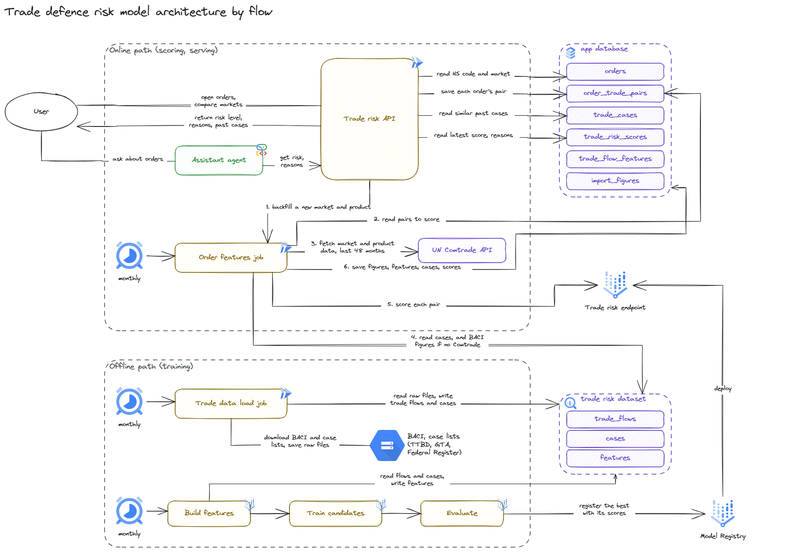

# Trade defence risk model: design

What each test found (baseline, Comtrade backtest, training):
[`TRADE_DEFENCE_RISK_RESULTS.md`](TRADE_DEFENCE_RISK_RESULTS.md). Data sources, files and how to run
it: [`ml/README.md`](../README.md).

Target architecture (the finished system):

## The use case

An anti-dumping, anti-subsidy or safeguard case is the most damaging trade news an exporter can get:
duties of 20–200% that can shut a market for years, often with deposits charged from the preliminary
decision, months before the final one. By the time the news says "investigation opened", it is late.

But these cases don't come out of nowhere. To open one, the importing country's industry must show
that imports rose fast, that their prices are low, or both. That shows in trade figures a year or more
before the petition. **The model reads those figures and says, for one importing market, one
exporting country and one product (HS 6-digit): how likely is an anti-dumping or anti-subsidy case
in the next 12 months, and why.**

Example: "Plywood and MDF (HS 441192) from Vietnam into India: high risk. Imports grew 4× in a year,
Vietnam holds 19% of India's imports of it, and India opened cases on the same product against two
other countries in the last two years."

Safeguards are left out: a safeguard targets every exporter at once ("protect this product from
everyone"), not one exporting country, so it can't be this model's label. It would be a separate,
simpler question (market and product only).

## Why a trained model and not Gemini

- **There's no text to read yet.** Before a petition there is no news; the signal is in millions of
  trade figures (every market × exporter × product × year). Gemini doesn't have them and can't turn
  them into a probability.
- **The answer is a ranked probability that can be checked.** We test it year by year on
  2019–2023, each year with a model trained only on the years before, on cases it never saw: we can
  say how many real cases it flagged in advance.
- **The labels are official records, not our opinion.** Each past case has its importer, exporter,
  products and opening date. The severity model's weak point (labels written by us) goes away.
- **Gemini does what it's good at around it:** reads the news, explains the model's reasons in plain
  words for this company's orders, and suggests what to do. The model gives the number and the
  reasons; Gemini never makes up the number.

## What it hits in the app

| Where | What the user sees | How |
| --- | --- | --- |
| **Orders** (list and order page) | A risk level (low, medium, high) on each order's market and product, with the top reasons | Trade risk API reads the saved score for the order's destination market, the company's country and the order's HS code |
| **Trade map what-ifs** ("what if this order went to Korea instead?") | Risk for each market side by side | The same score for each market compared (`trade_map.py`, `scenarios.py`) |
| **Assistant** ("Is my plywood to the US at risk of anti-dumping duties?") | An answer grounded on the score, its reasons and similar past cases, with advice (spread orders across markets, prepare cost records, watch the petition) | A tool for the assistant's agents calls the Trade risk API |
| **News watch** | When a real "investigation opened" story arrives, the alert says whether we warned about it before, and how many months ahead | The scan looks up the risk for the story's market, origin and HS code |

## Offline path (training)

### 1. Load data and build features

The **Trade data load job** (Cloud Run, monthly; does work only when a source has a new release)
downloads each source into the Cloud Storage bucket as raw files, then loads it into the BigQuery
dataset `trade_risk`:
- `trade_flows`: one row per (market, exporter, HS 6, year) with import value (USD) and tonnes,
  from CEPII **BACI** (HS 2012 edition, version 202601, 2012–2024), for the 40 markets in the case
  list. Customs unions are one market each (see "Data preparation").
- `exporter_totals`: one row per (exporter, HS 6, year): what the country exported of the product
  to the whole world, also from BACI.
- `cases`: one row per (case, market, exporter, HS 6): kind (anti-dumping or anti-subsidy), opening
  date, final measure date, revocation date, duty or margin, product name, source. From the World
  Bank **Temporary Trade Barriers Database** (TTBD, 40 markets, 1977 to about September 2024), plus
  the US **Federal Register** initiation notices from 2023 on, where TTBD has gaps and after it ends.
  GTA isn't used for labels: our export covers wood only.

Terms: BACI is Etalab Open Licence 2.0 (any use, cite "CEPII BACI"); TTBD states no licence (public
research data, cite Bown, Cieszkowsky, Erbahar, Signoret 2020); the Federal Register is public
domain; the WITS HS concordance tables are World Bank public data.

Code: `ml/trade_risk/` (branch `trade-risk-model`); how to run it: `ml/README.md`.

#### Data preparation: how the raw data is cleaned

All cleaning is done by the scripts, never by hand: the raw files stay exactly as downloaded, and
running the scripts again rebuilds every table the same way. Each fix below says where it lives.

Cases (`trade_risk/cases.py`):

| Problem in the raw data | What the script does | Why it matters |
| --- | --- | --- |
| Taiwan is `TWN` in TTBD but `S19` ("Other Asia, nes") in BACI | Renames BACI's `S19` to `TWN` | 1,253 Taiwan case rows matched no trade, and those flows were labelled "no case" |
| Old or mistyped country codes (`FRG`, `POR`, `NWY`, `JDN`, `ROM`) | Maps them to today's codes (DEU, PRT, NOR, JOR, ROU) | Cases of the 1980s–90s count in the history features |
| Some cases target "the EU" as a whole (`EUN`), but BACI lists each member state | The case counts against each of the 27 members | Only members that really export the product ($1M or more) become rows; the others drop out |
| 42 UK "cases" of 2020 are EU duties carried over at Brexit, not new investigations | Drops cases whose notes say "adopted from the EU after Brexit" | They would be false labels |
| Products are written in the HS edition in force when the case opened (1988, 1996, 2002, 2007, 2012, 2017, 2022), often at 8 or 10 digits; BACI uses HS 2012 | Cuts codes to 6 digits and maps them to HS 2012 with the WITS concordance tables, using the edition in force at the case's date (then the nearest ones). A code that was split maps to all its HS 2012 codes | 11% of case codes weren't valid HS 2012 codes (17% in 2024): for example every plywood case since 2022 (HS 2022 split 4412) |
| A case lists only a 4-digit heading | Labels every HS 2012 product under that heading; 2-digit chapters are dropped (too broad) | 905 product rows list headings |
| Excel dropped leading zeros (`303.79` for `0303.79`) | Restores them from the code's length | Products of chapters 01–09 |
| The "other markets" file (Egypt, Morocco, Vietnam as an importer, and 7 more) lists codes only in a notes column | Reads the codes from the notes text | Adds markets the baseline skipped |
| Opening date missing (mostly US cases before 1995) | Uses the earliest other date of the case (preliminary or final decision) | Old cases still count in the history |
| Dates in several formats (`2000-03-03`, `03/03/2000`, `Dec 2016`) | Reads all of them | A strict reader turned the US-style ones into blanks |
| Whether a duty is still in force: TTBD writes a revocation date, `IF` (in force at its last update) or `MI` (unknown) | Keeps the difference: in force, revoked on a date, or end unknown. A duty whose end is unknown counts as in force for 10 years after it was imposed (5 years, renewed once at the sunset review) | Treating every unknown end as "still in force" would keep duties of the 1990s alive forever |
| TTBD misses some US cases of 2023 and stops around September 2024 | Adds US cases from the Federal Register initiation notices: the exporters from the title, the products from every tariff code in the text (as TTBD lists them, including "may also enter under"). A notice is skipped when TTBD has the same case (same kind and exporter, opened within 60 days, a shared product), so it never widens a TTBD case | 203 US cases added: 12 in 2023, 45 in 2024, 68 in 2025, 78 in 2026. Checked against TTBD on 2023–2024: the notices find 94–100% of TTBD's US product rows |

Trade figures (`trade_risk/trade_flows.py`):

| Problem | What the script does | Why |
| --- | --- | --- |
| Customs unions open cases for all their members at once | The EU (27 members), the Eurasian Economic Union (Russia, Kazakhstan, Belarus, Armenia, Kyrgyzstan) and the Gulf Cooperation Council (Saudi Arabia, UAE, Kuwait, Qatar, Bahrain, Oman) are one market each: members' imports summed, trade between members dropped. Saudi Arabia's own few cases count as the Gulf's | Their duties apply at the union's border, on imports from outside it |
| BACI values are in thousands of US dollars; a few flows have no tonnes | Multiplies by 1,000; a flow keeps "no tonnes" when none was reported, and price features are left empty for it | Prices from missing tonnes would be wrong |
| Markets that never appear in the case lists | Left out of training | The app needs a rule for them: "this market rarely opens such cases" or "no data" |

Rows and labels (`trade_risk/features.py`):
- Only flows of at least $1 million a year become rows (about 450,000 a year). 71% of cases have
  at least one product above that the year before; most of the rest are cases against "the EU"
  spread to members that don't export the product.
- A row's label is known when its next year's case list is complete: every market up to the 2023
  rows (cases of 2024; TTBD's last quarter of 2024 is missing outside the US), the US only for the
  2024 rows (cases of 2025, from the Federal Register).

**Build features** (Vertex AI) reads both and writes `features`: one row per
**(market, exporter, HS 6-digit product, year)**, for flows of at least $1 million. Every column of
`features`, with an example row: plywood (HS 441192) exported from Vietnam into India, 2023.

| Group | Column | What it means | Example | Built from (BigQuery) | Source |
| --- | --- | --- | --- | --- | --- |
| Label | `case_opened_next_year` | 1 if the market opened an anti-dumping or anti-subsidy case against the exporter on this product in the following year, else 0. This is what the model predicts. | 1 | `cases` | TTBD; Federal Register (US) from 2023 |
| Size | `import_value_usd` | How much the market bought of this product from the exporter in the year, in US dollars. Big flows draw cases. | $40M | `trade_flows` | BACI |
| | `market_import_value_usd` | How much the market bought of this product from all exporters together in the year. Big markets for a product draw cases. | $210M | `trade_flows` | BACI |
| Growth | `import_value_vs_last_year` | The market's imports of this product from the exporter this year, divided by last year's. A sudden surge is what a petition must show. | 4.0 (grew 4×, from $10M) | `trade_flows` | BACI |
| | `import_value_vs_3_years_ago` | The same imports this year, divided by three years before: a surge that built up over several years. | 6.5 | `trade_flows` | BACI |
| | `import_tonnes_vs_last_year` | The same as `import_value_vs_last_year` but in tonnes. If tonnes grew faster than value, the exporter's prices fell. | 4.6 | `trade_flows` | BACI |
| | `is_new_flow` | True if the market bought none of this product from the exporter the year before: a brand-new source. | false | `trade_flows` | BACI |
| Share | `exporter_share_of_market` | The exporter's part of all the market's imports of this product. A big share is the "imports from X took our market" argument. | 0.19 (19%) | `trade_flows` | BACI |
| | `exporter_share_change_1y` | The exporter's share this year minus its share last year, in percentage points: how fast it is taking the market. | +0.12 (from 7% to 19%) | `trade_flows` | BACI |
| | `exporter_share_change_3y` | The exporter's share this year minus its share three years before: the same over a longer run. | +0.15 | `trade_flows` | BACI |
| Price | `unit_price_vs_last_year` | The exporter's price per tonne this year divided by last year's. Falling prices point to dumping. | 0.87 (13% cheaper) | `trade_flows` | BACI |
| | `unit_price_vs_market_average` | The exporter's price per tonne divided by the average price of all the market's imports of this product. Selling below everyone else points to dumping. | 0.70 (30% below) | `trade_flows` | BACI |
| Market | `market_imports_vs_last_year` | The market's imports of this product from all exporters this year, divided by last year's. Fast-rising imports put pressure on the market's own producers. | 1.4 | `trade_flows` | BACI |
| | `market_imports_vs_3_years_ago` | The same, against three years before. | 1.9 | `trade_flows` | BACI |
| Market (new) | `import_growth_vs_market_growth` | `import_value_vs_last_year` divided by `market_imports_vs_last_year`: how much faster this exporter's sales grew than the market's imports of the product as a whole. Taking the market, not riding a general rise. | 2.9 (4.0 against 1.4) | `trade_flows` | BACI |
| Competition (new) | `exporter_rank_in_market` | Where the exporter ranks among all the countries supplying this product to the market, by value (1 = the biggest). Cases go after the leading suppliers. | 2 | `trade_flows` | BACI |
| | `market_supplier_count` | How many countries supply this product to the market. With few suppliers, one fast-growing exporter stands out. | 24 | `trade_flows` | BACI |
| Exporter worldwide (new) | `exporter_world_exports_vs_last_year` | The exporter's exports of this product to every country this year, divided by last year's. A country exporting much more everywhere is often building capacity or diverting goods shut out elsewhere. | 1.6 | `exporter_totals` | BACI |
| | `exporter_share_of_world_exports` | The exporter's part of the world's exports of this product. Dominant exporters are cased more. | 0.12 (12%) | `exporter_totals` | BACI |
| Product | `hs_chapter` | The first 2 digits of the product's HS code. Some chapters (steel, chemicals, wood) get far more cases than others. | 44 (wood) | `trade_flows` | BACI |
| History | `past_cases_same_market_exporter_product` | How many cases the market has ever opened against this exporter on this product. Cases repeat. | 0 | `cases` | TTBD; Federal Register (US) from 2023 |
| History (new) | `years_since_last_case_same_market_exporter_product` | Years since the market's last case against this exporter on this product; empty if never. Sunset reviews come 5 years after a duty, and new cases follow old ones. | empty | `cases` | TTBD; Federal Register (US) from 2023 |
| History (new) | `measure_in_force_same_market_exporter_product` | 1 if a duty from an earlier case on this exporter and product is still in force in the market. A duty already there usually means no new case is needed. | 0 | `cases` | TTBD |
| History (new) | `market_duties_in_force_on_product_against_others` | How many other exporting countries face a duty in force in the market on this product. When one country is shut out, its trade moves to the next, which is then cased too (US duties on Chinese plywood from 2017, then Vietnam's case in 2025). Flows with such a duty get a case 20 times more often. | 1 (China) | `cases` | TTBD |
| History (new) | `market_duties_in_force_on_heading_against_others` | The same for related products (same 4-digit heading). | 1 | `cases` | TTBD |
| History | `market_cases_on_product_last_5y` | How many cases the market opened on this product, against any exporter, in the last 5 years. The market's industry already uses these tools for this product. | 2 | `cases` | TTBD; Federal Register (US) from 2023 |
| History (new) | `market_cases_on_heading_last_2y` | How many cases the market opened on related products (the same 4-digit HS heading, e.g. 4412 plywood) in the last 2 years. Cases spread to close products. | 3 | `cases` | TTBD; Federal Register (US) from 2023 |
| History | `other_exporters_cased_on_product_last_2y` | How many other exporting countries the market targeted on this product in the last 2 years (this exporter's own case not counted). When they are hit, trade moves to the next country, which then gets a case too. | 2 (China, Indonesia) | `cases` | TTBD; Federal Register (US) from 2023 |
| History | `other_markets_casing_exporter_last_2y` | How many other markets opened a case against this exporter on this product in the last 2 years (this market's own case not counted). One market's case tends to spread to others. | 1 (the US) | `cases` | TTBD; Federal Register (US) from 2023 |
| History (new) | `market_cases_against_exporter_last_5y` | How many cases the market opened against this exporter, on any product, in the last 5 years. Some markets keep targeting the same countries. | 6 | `cases` | TTBD; Federal Register (US) from 2023 |
| History (new) | `cases_on_product_all_markets_last_2y` | How many cases every market together opened on this product in the last 2 years. A product cased around the world is likely cased again. | 4 | `cases` | TTBD; Federal Register (US) from 2023 |
| History (new) | `cases_against_exporter_all_markets_last_5y` | How many cases every market together opened against this exporter, on any product, in the last 5 years. | 35 | `cases` | TTBD; Federal Register (US) from 2023 |
| History | `market_cases_opened_this_year` | How many cases the market opened this year, on any product and any exporter. Some markets use these tools far more than others. | 31 | `cases` | TTBD; Federal Register (US) from 2023 |
| History (new) | `market_cases_opened_last_3y` | The same over the last 3 years, steadier than one year. | 120 | `cases` | TTBD; Federal Register (US) from 2023 |

The 14 features marked "new" were added on 24 Nov 2026. Training compares the design's first 19
features against all 33 (`lightgbm_baseline_features` in the comparison) and all 33 against all
but the last three added (`lightgbm_without_duty_features`); a new feature stays only if the test
years show it helps. Both helped, so all 33 stay ([results](TRADE_DEFENCE_RISK_RESULTS.md),
"Which features help").

"Growth" means how much a figure changed against an earlier year, as a ratio: 1.0 is unchanged,
4.0 is four times as much, 0.5 is half. Ratios rather than dollar differences, so a $1M flow and a
$1B flow are comparable.

The label is empty for the latest year (its next year hasn't happened). The cases from 2025 on are
the labels of the 2024 rows; without them the newest year we can train and test on is 2023.

No feature says which country the market is: the model learns patterns that hold across markets.

Build features only writes training data (BigQuery `features`); it never touches the app's tables.

### 2. Train, evaluate, deploy

1. **Tune** (Vertex AI): a random search of each model's settings (LightGBM 25 tries, XGBoost 15,
   LightGBM's random forest mode 10, CatBoost 8, random forest 5, logistic regression 5). Each try
   is trained on the years before 2016 and scored on 2016, then the same for 2017 and 2018; the
   settings with the best average precision over the three years win. Three years rather than one,
   so the winner isn't fitted to one year's quirks ([results](TRADE_DEFENCE_RISK_RESULTS.md),
   "First pass").
2. **Compare** (walk-forward): for each test year 2019–2023, every candidate is trained only on the
   years before it and scores that year, as the yearly retrain will; no test year is used for
   tuning. Candidates: two hand-written rules (for reference: "share grew fastest", "this product is
   already being cased"), logistic regression, random forest, LightGBM's random forest mode, a small
   neural network, LightGBM, XGBoost, CatBoost; two averages (the three boosted models, their
   log-odds averaged; the same plus both forests, their ranks averaged); and LightGBM with fewer
   features (the design's first 19, all but the three newest, trade only, history only). Training
   keeps every case row and 10% of the others, weighted back up: about 10× faster, same ranking.
   Measured per test year: average precision (the main one: how high the real cases rank), AUC, the
   share of real case rows in the top 1% and 5% of the year's rows; and per case, how many of the
   cases opened had a row in the top 1% or 5% a year before.
3. **Check** the chosen model: by market, with big markets left out of training entirely, exports
   from Vietnam, and the 2025 US cases (trained up to 2023, scoring the 2024 figures).
4. The best is registered in the **Model Registry** with its scores and the score cut-offs of the
   top 1% and top 5% of the latest year's rows (what "high" and "medium" mean), and deployed to the
   endpoint. A new version makes the Order features job score every saved pair again.

The comparison picked the average of LightGBM, XGBoost and CatBoost
([results](TRADE_DEFENCE_RISK_RESULTS.md)): the endpoint runs the three models, averages their
log-odds into one probability, and averages their SHAP values into the reasons (exact, since SHAP
values add up). The Order features job sees one model.

Training and the Order features job are separate jobs: training runs yearly (when BACI adds a year)
and writes a model version; the Order features job runs monthly and uses the latest version. The
version is all they share, and training never reads what the Order features job writes.

Data volume: BACI is 1.3 GB zipped (about 9 million flows a year); after the $1 million cut the
feature table is about 400,000 rows a year.

### Limits of the data

1. **The case list stops around September 2024.** Checked on 24 Nov 2026 against the Federal
   Register: TTBD has no US case after September 2024, and misses some of 2023. **Fixed for the US**
   (the Federal Register fills 2023 to today); **still open elsewhere**: outside the US, the 2023
   rows' labels (cases of 2024) miss about the last quarter, so a real case can be labelled 0, and
   the 2024 rows have labels for the US only. A source for other markets (the WTO's semi-annual
   reports, the EU's Official Journal, India's DGTR) would close it.

2. **Products in cases are written in different HS editions.** **Fixed** on 24 Nov 2026: every
   case code is mapped to HS 2012 with the WITS concordance tables (see "Data preparation"). What
   remains: a code split in a newer edition maps to all its HS 2012 codes, so a few labels are wider
   than the case.

3. **The trade figures are per year, so the warning is per year.** BACI gives one total per year
   for each (market, exporter, product). The model can say "a case is likely next year", not "next
   month", and a surge that started in November looks small until the next year's total.

4. **BACI comes out late, so today's scores rest on old figures and look at a year that is over.**
   BACI's figures for a year are published about 13 months after it ends: the 2024 figures came out
   in January 2026, and 2025 will come out around January 2027. Today (November 2026) the newest row
   we can build is 2024. The model was trained to answer "given year t's figures, will a case open in
   year t + 1?" So with 2024 figures it answers "will a case open in 2025?"

   2025 is over, so that answer tells the user nothing new. The model itself is fine: it learned
   "12 months of figures → a case in the 12 months after", which doesn't depend on the year. Only
   the input at scoring time must be recent, and BACI can't give that.

   Fix: **score with UN Comtrade's monthly figures, keep training on BACI.** Comtrade publishes
   monthly imports as the countries report them, about 3 months after the month ends. Checked on
   23 Nov 2026: plywood (HS 4412) from Vietnam into the US, India and the EU has figures up to
   August 2026; September is not in yet. At scoring time, the API builds the features from the last
   12 months (September 2025 to August 2026) for the pairs it scores, and the model predicts the 12
   months after. Conditions:
   - The features must be computed the same way as in training (12-month totals, the same growth
     and share formulas). BACI is built from Comtrade but cleaned (it reconciles both sides'
     reports), so the numbers are close, not identical. The Comtrade backtest
     ([results](TRADE_DEFENCE_RISK_RESULTS.md)) checked it: scored from Comtrade's 2023 figures,
     the model flagged the cases of 2024 as well as from BACI's.
   - Retrain each year when BACI adds a year, so the model follows recent patterns.
   - Markets that report monthly figures late or not at all fall back to BACI, and the answer says
     the figures are older.
   - A free Comtrade API key (500 calls a day): enough for the pairs a company's orders need, not
     for every pair in the world, which is why training stays on BACI.

## Online path (scoring, serving)

### Order features job (fresh figures, scores)

The model is trained on BACI, but BACI is a year or more behind (see "Limits of the data"), so
the features the job scores come from UN Comtrade's monthly figures instead.

The **Order features job** (Cloud Run, monthly) is the only job that writes the app's tables.
For every (market, exporter, HS 6) that companies' orders need:
1. It downloads from UN Comtrade the months not yet in the Postgres table `import_figures`: the
   market's imports of that product from every exporter, for the last 48 months (the share and
   market features need every exporter, the 3-year features need 36 months before).
2. Where Comtrade has no full recent 12 months for that market (it reports late or not monthly),
   it takes the BACI years for that market and product from BigQuery `trade_flows` instead.
3. It saves both to `import_figures`, each row marked with its `source`.
4. It computes the features from `import_figures` exactly as Build features does (12-month totals:
   the latest 12 months for Comtrade, the latest year for BACI) into `trade_flow_features`, with
   `data_source` and the period they cover.
5. It copies the cases from BigQuery `cases` to `trade_cases` (for "similar past cases"), and uses
   them for the history features, up to today.
6. It scores each pair whose features changed (or every pair, after a new model version) with the
   **Vertex AI endpoint**: the probability and each feature's contribution. It turns them into a
   level (the score against the version's 1% and 5% cut-offs) and the top reasons in words, and
   adds a row to `trade_risk_scores`. Scores change only when the figures or the model do (monthly
   at most), so scoring here, not per request, gives the same answer on every read and keeps the
   endpoint's work to one batch a month plus backfills.

Until training moves to Google Cloud, step 6 loads the model files (the three models and their
cut-offs, `ml/models/trade_risk/<date>/`) into the job and scores them there; no endpoint.

**As built (25 Nov 2026, `ml/trade_risk/order_features.py`, `scoring.py`):**
- **Which pairs:** the backend keeps each order's pair in `order_trade_pairs` (one row per order,
  written when an order is saved, edited or imported, deleted with the order; refreshed when its
  risk is read, e.g. after the company's country changed). It is matched to the other tables by
  value (market, exporter, hs6), not by key: a new pair has no score yet, and scores keep a row
  per scoring. `--new` scores the pairs there with no score (the backend starts it after saving
  orders); the monthly run refreshes those pairs and every pair scored before (what-ifs, and
  orders since deleted: the cleanup can come later); `--pair` scores one named pair (what-ifs).
- **Codes:** Postgres uses alpha-2 countries (EU, EAEU and GCC for the customs unions); the job
  converts to the model's alpha-3 with BACI's country list. `hs6` is the order's code (HS 2022);
  `model_hs6` is its HS 2012 code, from the WITS conversion file (HS 2022, then HS 2017; a code
  already in HS 2012 stays). Comtrade is asked with the order's code, the model and cases use
  `model_hs6`.
- **Comtrade:** 51 months asked for (the 48 the features need, plus 3 because countries report 2
  to 4 months late), 12 a call: about 5 calls a new pair, 1 a month after. The latest month with
  figures must be within 9 months, and both the latest 12 months and the 12 before complete;
  otherwise BACI. Comtrade's estimated weights (the US reports none) count as missing, so price and
  tonnage features are empty there rather than every exporter getting the same price.
- **Exporter's world exports** (2 features) come from BACI's latest two years: Comtrade would need
  a call per exporting country.
- **History features** count cases up to today's year, for Comtrade and BACI figures alike.
- **Features** are one JSON column in `trade_flow_features` (the list can change between model
  versions), not a column each.
- **No score:** `no_data` with a note when there are no recent imports of the product from that
  country, or under $1M a year (the model trained on flows of at least $1M; old features are
  deleted then). A market that has never opened a case is `low` with no score and a note.
- **Reasons** that would quote a dollar amount ("sells $40M a year") are worded without it ("a
  large supplier"): the figures are Comtrade's.
- **Percentile:** the share of the model's 2024 reference rows that scored lower, from 1,001
  quantiles saved with the model (`score_quantiles.json`).
- A score row is added only when the level, score, figures' period, note or model changed.

| `trade_risk_scores` column | Meaning |
| --- | --- |
| `market`, `exporter`, `hs6` | The pair scored |
| `score` | The probability of a case in the next 12 months |
| `level` | `high`, `medium` or `low` |
| `reasons` | The top features that raised the score, each with its contribution and words (JSON) |
| `model_version` | The model that scored it |
| `data_from`, `data_to`, `data_source` | The period the figures cover and where they came from (Comtrade or BACI), copied from the features |
| `scored_at` | When it was scored |

A new scoring adds a row and never overwrites one: the API reads the latest per pair, and the history
is kept so News watch can say "we warned about this N months before the case opened", and so we can
check later how earlier scores turned out.

| `import_figures` column | Meaning |
| --- | --- |
| `market`, `exporter`, `hs6` | Who imports, from whom, which product |
| `period` | A month (`2026-08`) for Comtrade, a year (`2024`) for BACI |
| `period_kind` | `month` or `year` |
| `value_usd`, `tonnes` | What the market imported in that period |
| `source` | `comtrade` or `baci` |
| `fetched_at` | When it was downloaded; a period already here is never downloaded again |

Only the pairs orders need are kept (thousands of rows, not BACI's millions): the full BACI stays
in BigQuery for training.

**Backfill:** when an order is saved, edited or imported with a pair that has no score, the backend
starts the same job (`--new`: about 5 Comtrade calls and one score a pair, under a minute
locally), so the score is almost always ready before anyone opens the order. A what-if pair with
no score starts it with `--pair`. Either way the API answers `pending` until the score is there.
We assume Comtrade calls are not limited (one user for now); the free key's 500 a day would make
extra pairs fall back to BACI that day.

So BACI trains the model, and Comtrade feeds what it scores. Comtrade's terms allow this internal
use; the app shows scores and reasons, never the raw figures, and credits "Source: UN Comtrade".

**Rule: training uses BACI only; `import_figures` never goes back into training.** Mixing the two
would count the same trade twice (BACI is built from Comtrade), teach the model the difference
between sources instead of trade patterns (Comtrade is raw and noisier), and add a small, biased
sample (only the pairs orders need). The Comtrade backtest
([results](TRADE_DEFENCE_RISK_RESULTS.md)) checked exactly this split: trained on BACI, scored from
Comtrade.

The BACI fallback is not leakage: the latest BACI year has no label yet (its next year isn't in
the case lists), so the model never trained on it. Its cost is age: a score from 2024 figures
looks two to three years ahead, and in the backtest two-year-old figures found 16 cases where
fresh ones found 23. The answer says which figures it used.

### Trade risk API: what it reads

All in Postgres. The API only reads these tables; it never calls Comtrade or the model itself.

| Table | One row per | What the API takes from it |
| --- | --- | --- |
| `orders` (exists) | order | `hs_code` (first 6 digits) and `destination` (the market) |
| `order_trade_pairs` | order | The order's pair (market, exporter, HS 6), saved by the backend with the order; the job reads it for the pairs to score |
| `company_sites` (exists) | site | `country_alpha2` of the company: the exporter |
| `trade_risk_scores` | market, exporter, HS 6, scoring | The latest score, level, reasons, model version and the period of the figures |
| `trade_flow_features` | market, exporter, HS 6 | Every feature of the offline table, from the latest 12 months; `data_from`, `data_to`, `data_source` (Comtrade or BACI); no label. Read by the Order features job to score; the API reads only whether a pair has figures yet |
| `import_figures` | market, exporter, HS 6, period | The imports the features were computed from (Comtrade months, or BACI years as the fallback), with `source`; for tracing a score to its figures. Not read per request |
| `trade_cases` | case and HS 6 | The same columns as `cases`, for "similar past cases" and the history behind the reasons |

The company's orders are only used here, to choose which (market, exporter, HS 6) to score. The
model never trains on them.

### Trade risk API: steps

1. A person opens their orders or compares markets on the trade map; or asks the assistant, whose
   agent calls the same API.
2. **Trade risk API** (backend, Cloud Run) reads the order's HS code and destination from `orders`
   and the company's country, then the latest row for that (market, exporter, HS 6) from
   `trade_risk_scores`: score, level and reasons.
3. **If there is no row yet** (an order just brought a new pair and its backfill is still running,
   see "3. Order features"): the page shows "loading figures" and asks again after about 10 seconds. If there is
   still no row, it shows "No data available" for that order. A BACI row counts as a row: it is used
   until the Comtrade one replaces it, and the answer says how old its figures are.
4. It adds similar cases from `trade_cases` and returns it.
5. The assistant's agent explains it for this company's orders, with Gemini.

The rows in `trade_flow_features` and `trade_risk_scores` are written offline: see "3. Order
features" in the offline path. A pair with no figures at all (a new flow) gets "no data", not "low".

### Trade risk API: output

For one (market, exporter, HS 6-digit):
- **Risk level** low, medium or high, from where the score ranks among all the rows scored that
  year: **high = the top 1%, medium = the next 4% (top 1–5%), low = the rest**. A rank, not a
  probability: even at the top the probability is small (about 1 in 900 rows has a case the next
  year), so "high: cases followed N times more often than average" reads better than "3%". The
  walk-forward test measures each level's real case rate, and the app says it.
- **Top reasons:** the features that pushed the score up most (from the model's own explanation of
  each prediction), in words: "imports grew 4× in a year".
- **Similar past cases:** the closest earlier cases: the market's cases on the product (against
  this exporter first), then other markets' cases on it, then related products in the market; with
  their outcome and duty.
- The model version and the data year, so a person can tell how fresh it is.

## Build plan

1. **Done (24 Nov 2026):** the code is in `ml/trade_risk/` (`cases`, `trade_flows`, `features`,
   `train`, `final_model`, `explain`), with the data cleaning above.
2. **Done for the US (24 Nov 2026):** 2023–2026 cases from the Federal Register. Other markets
   after September 2024: still open (limit 1).
3. **Done (25 Nov 2026):** models compared and the chosen one trained on 2013–2023, with
   per-prediction reasons (SHAP) and similar past cases (`explain.py`). Results:
   [`TRADE_DEFENCE_RISK_RESULTS.md`](TRADE_DEFENCE_RISK_RESULTS.md).
4. **Built (25 Nov 2026, branch `trade-risk-model`, not merged):** the `order_trade_pairs`, `import_figures`,
   `trade_flow_features`, `trade_risk_scores` and `trade_cases` tables (one migration); the Order
   features job (`ml/trade_risk/order_features.py`), scoring with the model files loaded into the
   job; the Trade risk API (`GET /trade-risk/orders/{id}`, `GET /trade-risk`, which starts the job
   for a pair with no score); each order's pair saved on save, edit and import, starting the
   job for new pairs; the assistant's `get_trade_risk` tool. Checked end to end locally
   (US and Korea plywood from Vietnam). Not yet: the job's image and Cloud Run job, a golden case
   for the tool.
5. Show it on orders and the trade map what-if;
   link it from News watch alerts.
6. Move to Google Cloud (the drawing): training on Vertex AI with BigQuery, the Model Registry, and
   the endpoint the Order features job calls. Bucket and dataset wait until then.

Done when: on the test years it finds most cases in its top 5%, it is shown on orders and the trade
map, and the assistant answers from it.
